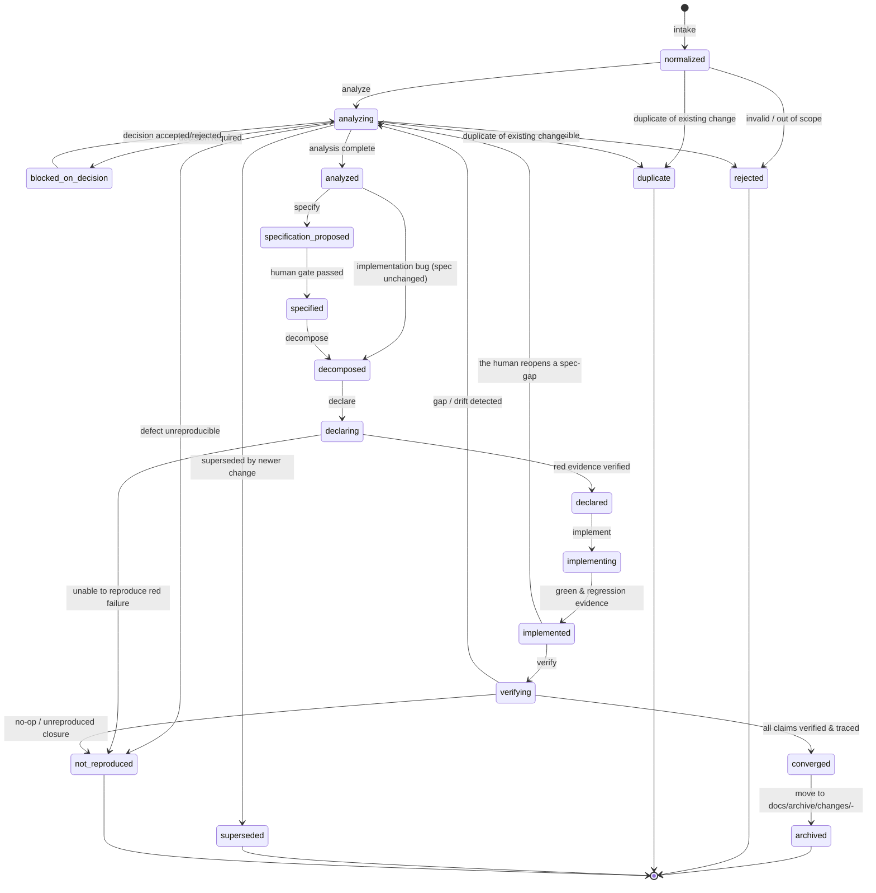
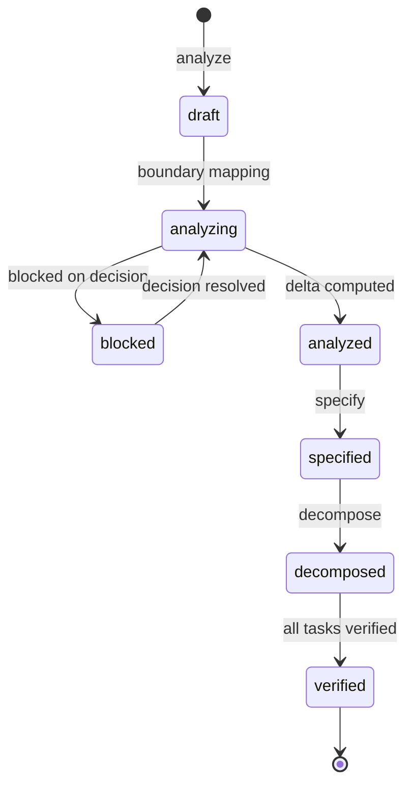
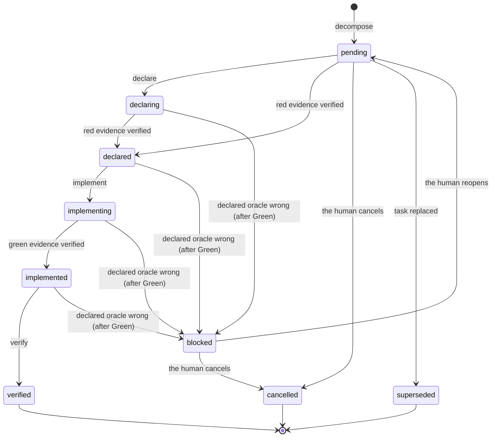
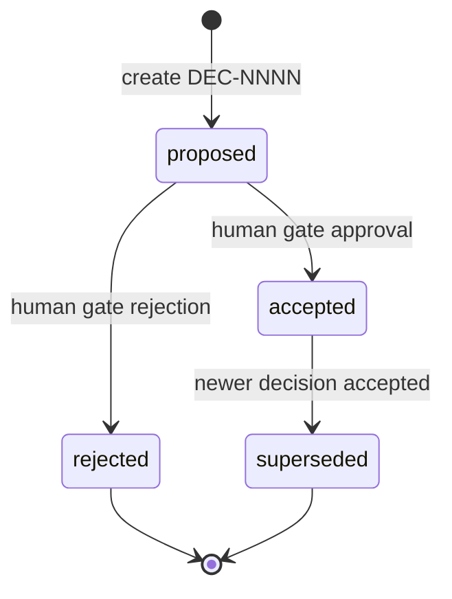
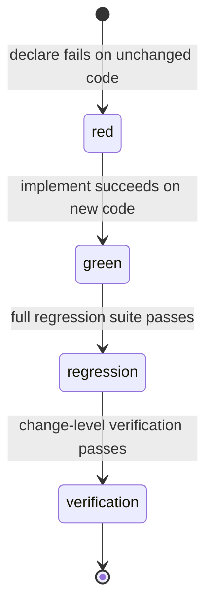

# State Machine Specification

[**English**](state-machine.md) | [Русский](state-machine.ru.md)

This document formally defines the state machines for the primary DeltaFuse entities: **Change**, **Slice**, **Task**, **Decision**, and **Evidence**.

---

## Change Lifecycle State Machine

A Change is the complete lifecycle container for an atomic set of modifications to a product.

### Complete Change Status Table

| Status | Description | Allowed Next Statuses | Transition Gate / Precondition |
|---|---|---|---|
| `normalized` | Initial normalized request in `CHG-NNN/request.md`. | `analyzing`, `rejected`, `duplicate` | Request passes schema and format checks. |
| `analyzing` | Routing and slice analysis in progress. `deltafuse next` names one Analyze pass at a time; `analyzed` still needs routing+slices covering every routing primary capability+coverage. | `blocked-on-decision`, `analyzed`, `rejected`, `duplicate`, `superseded`, `not-reproduced` | Initial capability routing mapped. |
| `blocked-on-decision` | Blocked waiting for human decision on a `DEC-*` record. | `analyzing` | At least one blocking decision in `proposed`. |
| `analyzed` | Routing, deltas, and slices computed; coverage mapped. `deltafuse next` names one Specify slice (`spec_refs` only), then `close`. A bugfix goes to Decompose instead. | `specification-proposed`, `decomposed` (bugfix: spec unchanged; the `decomposed` gate proves the exact `spec_refs`) | Zero unaccepted blocking decisions. |
| `specification-proposed` | Changes to `docs/spec/**` drafted in `spec-delta.md`. Entered only when every machine check of the `specified` gate passes except the two that are the human's to settle when they accept - their receipt, and a capability this Change routes into that is still a `draft`; otherwise `deltafuse state` refuses and returns the errors to the Worker. | `specified` | Human approval of specification delta. |
| `specified` | Normative specification updated (or proven unchanged for bugs). | `decomposed` | Live `docs/spec/**` files and a valid `_capabilities.yaml` exist, or unchanged spec is proven by exact existing `spec_refs`; `spec-delta.md` added/modified files must stay in slice `spec_refs`. `spec-delta.md` is not sufficient alone. |
| `decomposed` | Slices broken down into atomic dependency-ordered tasks. | `declaring` | All tasks validated against `task.schema.yaml`. |
| `declaring` | Preparing the declared Red oracle for tasks. `docs`/`ops` use a file or schema oracle, not product pytest. | `declared`, `not-reproduced` | The declared oracle fails for the expected public reason, proves unreproducible, or records `already-green` when the public oracle already passes. On `route: code` an `already-green` Red cannot carry `implemented`, so it stops the task: a task with `requirement_delta: none` is already met by the work around it and the Worker closes it as `superseded` (`deltafuse state --task <id> --status superseded`, which the Core allows only then; its test stays as regression); a task that promises a requirement delta halts for the human, who cancels it or has it declared again. A Change whose every requirement is already met still closes on the no-op path. Private `_` access is rejected on `route: code`. |
| `declared` | Verified Red evidence recorded for all tasks. | `implementing` | Human review of Red evidence if required. |
| `implementing` | Authoring minimal compliant change to turn the oracle green. | `implemented` | `code`: tests pass with Green and Regression, and the Red they answer actually failed - a Green answering an `already-green` Red proves no delta and does not close this gate. `docs`/`ops`: allowed files exist; no `src/**`. |
| `implemented` | All tasks implemented and verified locally. | `verifying` | `code` requires Green and Regression; `docs`/`ops` require Green (file/schema). |
| `verifying` | End-to-end traceability and convergence check. | `converged`, `analyzing`, `not-reproduced` | All claims mapped to green tests and spec (or no-op closure). |
| `converged` | Convergence proven; package ready for archiving. | `archived` | Verification evidence recorded; tasks are `implemented`, `verified`, `cancelled`, or `superseded`; spec-delta still matches `docs/spec/**`. Archive is not a spec merge. |
| `archived` | Moved to `docs/archive/changes/<date>-<change-id>`. | *Terminal* | Directory moved to archive root. |
| `rejected` | Rejected as unfeasible or out of scope. | *Terminal* | Rationale documented (optional `analysis.md` or Change notes). |
| `duplicate` | Identified as duplicate of another Change. | *Terminal* | Link to primary `CHG-*` documented in `change.yaml`. |
| `not-reproduced` | Defect not reproduced during analysis, declaring, or verification. | *Terminal* | Diagnostic proof or evidence recorded with `result: not-reproduced` in `evidence/` or `verification.md`. |
| `superseded` | Superseded by a newer or broader Change. | *Terminal* | Superseding Change reference recorded. |

No command writes `declaring`, `implementing` or `verifying` to a Change: the Worker's work in those phases is recorded on its tasks. `deltafuse advance` closes the next gate from the resting status and steps over the in-flight one — `decomposed` → `declared`, `declared` → `implemented`, `implemented` → `converged` — and the receipt records that step. A Change may still hold an in-flight status one legal step past its last receipt.

The `declaring` and `implemented` gates check every task that is not `cancelled` or `superseded`: each must be at the gate's status with its own evidence. Green and regression evidence are stamped with the `docs/spec/**` and `src/**` tree; a later task that changes it makes an earlier task's evidence stale, and `deltafuse next` sends the Worker to re-run that task's evidence on the current tree before the gate can close.

---

## Slice Lifecycle State Machine

A Slice is an autonomous, independently verifiable capability slice within a Change.

### Slice Statuses

| Status | Description | Allowed Next Statuses |
|---|---|---|
| `draft` | Slice boundary draft created during routing. | `analyzing` |
| `analyzing` | Delta computation and dependency analysis. | `blocked`, `analyzed` |
| `blocked` | Blocked waiting for architectural or domain decision. | `analyzing` |
| `analyzed` | Boundary, deltas, and affected modules resolved. | `specified` |
| `specified` | Applicable spec modifications completed and approved. | `decomposed` |
| `decomposed` | Tasks for slice created and dependency-ordered. | `verified` |
| `verified` | All slice tasks implemented and verified. | *Terminal* |

---

## Task Lifecycle State Machine

A Task is an atomic, independently verifiable work unit owned by a specific Slice.

### Task Statuses

| Status | Description | Allowed Next Statuses | Gate / Precondition |
|---|---|---|---|
| `pending` | Task defined in `tasks/TASK-NNN.md`. | `declaring`, `declared`, `cancelled`, `superseded` | Task matches `task.schema.yaml`. |
| `declaring` | Test target being written. | `declared`, `blocked` | Test runs and fails for expected reason. |
| `declared` | Verified Red evidence recorded. | `implementing`, `blocked` | Evidence file in `evidence/red/<task-id>.yaml`. |
| `implementing` | Implementation code being authored. | `implemented`, `blocked` | Tests pass; regression suite passes. |
| `implemented` | Green & regression evidence recorded. | `verified`, `blocked` | Evidence in `evidence/green/` & `regression/`. |
| `verified` | Cross-layer convergence confirmed by verifier. | *Terminal* | End-to-end verification step completes. |
| `blocked` | The declared oracle proved wrong; the run halts for the human. Reachable from `declaring`, `declared`, `implementing` or `implemented`. | `cancelled`, `pending` (the human only) | The Worker may set it (`deltafuse state <change-dir> --task <id> --status blocked`) only after the Core recorded Green against the oracle Red froze, with those tests unchanged; blocking reason documented. The human reopens with `deltafuse decide <change-dir> --task <id> --status reopened [--note "<why>"]`: the task's evidence moves to `reopened/<task>.<n>/`, its product files return to the copies the `declaring` gate took, a `task` gate receipt `reopened` is journaled, and that task alone may be declared again while its Change is `declared` or `implementing`. |
| `cancelled` | Task cancelled during Change lifecycle - the human's decision, never the Worker's: `deltafuse decide <change-dir> --task <id> --status cancelled` (Human Gate password when set; journaled as a `task` gate receipt). `deltafuse state` refuses it. | *Terminal* | Cancellation rationale documented. |
| `superseded` | Task replaced by finer-grained tasks. | *Terminal* | Superseding task IDs documented. |

---

## Decision Lifecycle State Machine

Decisions are recorded in `docs/decisions/DEC-NNNN-*.md` (decisions may be bound to a Change via `change: CHG-NNN`, or created at repository/Bootstrap level with `change: null`):

### Decision Invariants
- **AI may only draft** decisions in `status: proposed`.
- **Only a human** may transition a decision to `accepted` or `rejected`.
- An accepted decision becomes repository policy; its rationale cannot be silently revoked without a new superseding Decision.

---

## Evidence Lifecycle State Machine

Evidence is the machine-verifiable proof of behavior recorded at each critical stage:

### Evidence Phases and Locations

| Phase | Required Path | Scope | Task ID Requirement |
|---|---|---|---|
| `red` | `evidence/red/<task-id>.yaml` | Task test fails on unmodified production code. | Required (`task: TASK-NNN`) |
| `green` | `evidence/green/<task-id>.yaml` | Task test passes on updated production code. | Required (`task: TASK-NNN`) |
| `regression` | `evidence/regression/<task-id>.yaml` | Full domain regression suite passes without regression failures. | Required (`task: TASK-NNN`) |
| `verification` | `evidence/verification/run.yaml` | End-to-end Change verification run confirms all claims and deltas. | Optional / Null (`task: null`) |

---

## Versioning Invariants

1. **Schema Version Compatibility**: `change.yaml`, `_capabilities.yaml`, and `evidence/*.yaml` carry an explicit `schema_version: 3`. Change-nested artifacts (`tasks/*.md`, `slices/*.md`, `decisions/DEC-*.md`, `routing.yaml`, `coverage.yaml`) inherit the schema version of their parent Change and are validated fail-closed through the Change contract (V3-FIX-013); unknown top-level keys on `routing.yaml`/`coverage.yaml` are ignored.
2. **Deterministic Locking**: The `.deltafuse/lock.yaml` file stamps the exact framework version, source URI, content hash, and `workflow.auto_accept_decisions`. Products cannot proceed through gates if `config.yaml` version or source mismatches `lock.yaml`. `auto_accept_decisions: true` does not bypass Human Gate on proposed Decisions.
